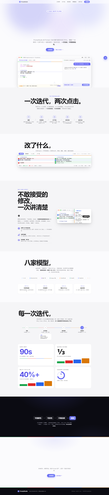
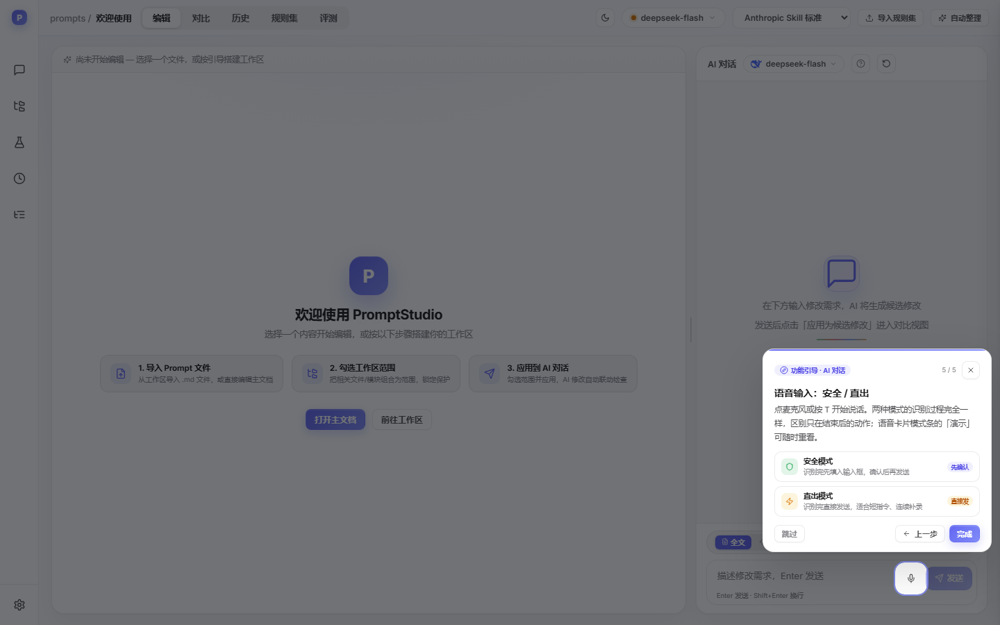
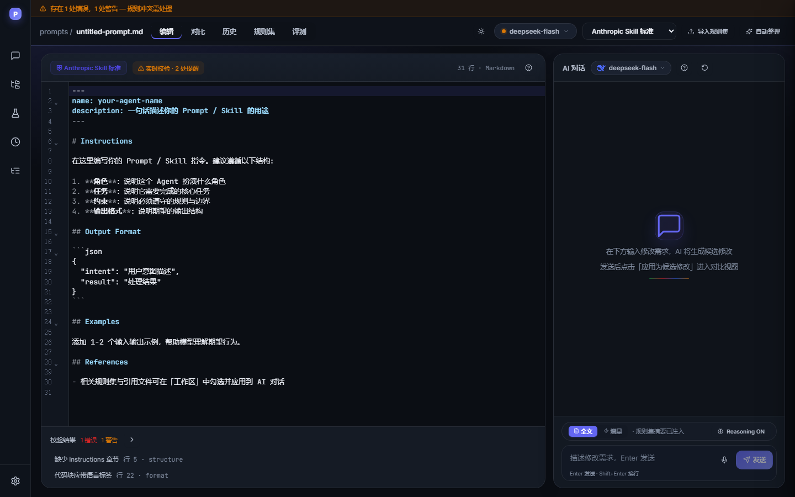
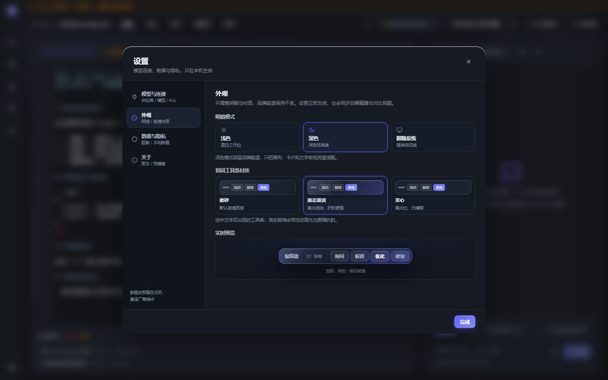

# PromptStudio — 提示词工作台

集成式 Prompt / Skill 编辑、多模型对话、可视化修改对比与提示词评测的一体化工作台。

[在线体验](https://zawsstt.github.io/prompt-studio/) · [模块功能说明](PromptStudio-模块功能说明.md) · [评测引擎设计](docs/eval-engine-2026-10-23.md)



## 核心能力

- **编辑与规则校验**：CodeMirror 6 编辑器，Markdown / YAML 高亮、自动补全、实时结构 / 顺序 / 格式校验，支持一键自动整理。
- **多模型 AI 对话**：OpenAI、DeepSeek、Anthropic、Gemini、通义千问、Moonshot、智谱 GLM、OpenRouter 八家供应商；流式输出、Reasoning 折叠、上下文自动注入、候选修改应用。
- **语音输入双模式**：安全模式识别完先填入输入框、确认后发送；直出模式识别完直接发送。两种模式在 AI 对话模块引导中直接对比演示。
- **Diff 对比与修改日志**：左右分屏同步滚动、四色变更标记、逐块接受 / 拒绝，Why / How / Effect 说明可编辑、可钉住。
- **版本时间线**：每次接受修改自动生成版本快照，支持回滚、重命名、导出变更日志与 `SKILL.md`。
- **提示词评测**：用例 + 7 类断言（contains / not-contains / regex / equals / json-valid / max-latency / llm-rubric）、结果矩阵、历史运行、回归基线、用例集快照与退化用例 changeBlock 定位。
- **工作区范围**：导入单文件 / 整个文件夹，按模块圈选安全区域并锁定，多文件联动检查引用。
- **设置中心与模型速切**：模型与连接 / 外观 / 数据与隐私 / 关于四个分区；顶栏模型胶囊一键速切，不重复设置入口。
- **明暗主题与模块引导**：浅色 / 深色 / 跟随系统；磨砂 / 液态玻璃 / 实心三种划词工具条材质。每个功能模块首次进入自动播放聚光灯引导，模块标题旁 `?` 可随时重播。
- **本地优先**：对话、版本、评测与工作区数据保存在 IndexedDB；API Key 优先写入系统凭据库，否则本地加密存储，不经过中间代理。

## 界面截图

| AI 对话引导 · 语音双模式 | 浅色语音卡片 |
|---|---|
|  |  |

| 深色编辑器 | 外观设置 |
|---|---|
|  |  |

## 技术栈

| 层 | 选型 |
|---|---|
| 前端 | React 18 + TypeScript 5.7 |
| 构建 | Vite 6（`base: './'`，可直接部署到任意子路径） |
| 状态 | Zustand 5 |
| 本地数据 | Dexie 4 / IndexedDB |
| 编辑器 | CodeMirror 6（Markdown / YAML / lint / autocomplete） |
| UI 图标 | lucide-react |
| 动效 | ThinkingOrb、BorderBeam + 自有 CSS 动效层 |
| 验收 | Puppeteer-core（Edge / Chrome headless） |

## 快速开始

要求 Node.js 20+。

```bash
# 安装依赖
npm ci

# 开发模式（http://localhost:3000）
npm run dev

# 类型检查 + 生产构建
npm run build

# 本地预览生产构建（http://localhost:4173）
npm run preview -- --port 4173 --strictPort
```

首次打开会依次出现欢迎卡、AI 对话模块引导与编辑区引导；也可以在「设置 → 关于 → 功能引导」重播全部模块引导。

## 项目结构

```text
src/
├── App.tsx                  # 应用入口、主题 / 快捷键 / 全局弹层
├── components/
│   ├── Chat/                # 对话面板、输入卡片、语音输入
│   ├── Editor/              # CodeMirror、校验面板、欢迎页
│   ├── Diff/                # 对比视图
│   ├── Eval/                # 评测、结果矩阵、回归基线
│   ├── Version/             # 版本时间线、分数曲线
│   ├── Workspace/           # 工作区范围与导入
│   ├── Ruleset/             # 规则集管理
│   ├── Settings/            # 设置中心、模型速切
│   ├── Layout/              # 导航、顶栏、AppShell
│   └── shared/              # 引导、Toast、通用弹窗
├── lib/
│   ├── eval/                # 断言、runner、基线、dataset 快照
│   ├── api/                 # 供应商适配与流式解析
│   ├── theme.ts             # 明暗模式 / 工具条材质
│   ├── tours.ts             # 各模块引导步骤
│   ├── validation.ts        # 规则校验
│   └── diff.ts              # 行级 / 字符级 diff
├── store/                   # Zustand 状态 + Dexie 持久化
├── styles/                  # 设计 token、主题层、引导层
└── types/                   # 领域类型

scripts/                     # Puppeteer 验收脚本（verify-*.mjs）
tests/                       # 评测引擎 / QA 单测入口
docs/                        # 设计、评测、竞品与界面截图
public/                      # 供应商图标等静态资源
```

## 验收与测试

先启动生产预览：

```bash
npm run preview -- --port 4173 --strictPort
```

然后按需运行：

```bash
npx tsc --noEmit
node tests/_eval.mjs                 # 评测引擎 / 基线 / dataset 快照
node scripts/verify-chat-tour.mjs    # 首屏 AI 对话引导 + 语音双模式
node scripts/verify-voice-theme.mjs  # 语音卡片浅色 / 深色
node scripts/verify-tours-theme.mjs  # 模块引导与主题
node scripts/verify-settings-center.mjs
node scripts/verify-chat-layout.mjs
node scripts/verify-p12-baseline.mjs
```

## 部署

仓库已配置 GitHub Pages：`.github/workflows/deploy.yml` 在 `main` 分支收到推送后执行 `npm ci` + `npm run build`，并把 `dist` 作为 Pages 产物发布。

- 线上地址：<https://zawsstt.github.io/prompt-studio/>
- Vite 使用相对 `base: './'`，因此 `dist` 也可以直接放到任意静态服务器或子目录。
- 如需更新线上页面，推送到 `main` 后等待 Actions 完成即可。

## 文档

- [模块功能说明](PromptStudio-模块功能说明.md)
- [评测引擎设计](docs/eval-engine-2026-10-23.md)
- [竞品分析](docs/competitive-analysis-2026-10-23.md)
- [Agent App 转换计划](docs/agent-app-conversion-plan-2026-10-23.md)
- [设计提案](design-proposal.md)

## 说明

- 品牌主体色为 Indigo `#6366F1`，明暗与工具条材质只改变表面层，不改变品牌色。
- `promptstudio.html`、`promptstudio-v2.html`、`promptstudio-app.html` 与 `css/`、`js/` 保留了早期静态原型，当前应用以 `src/` 中的 React + Vite 版本为准。
- 项目未附带开源许可证文件；如需对外分发，请先补充 License。
