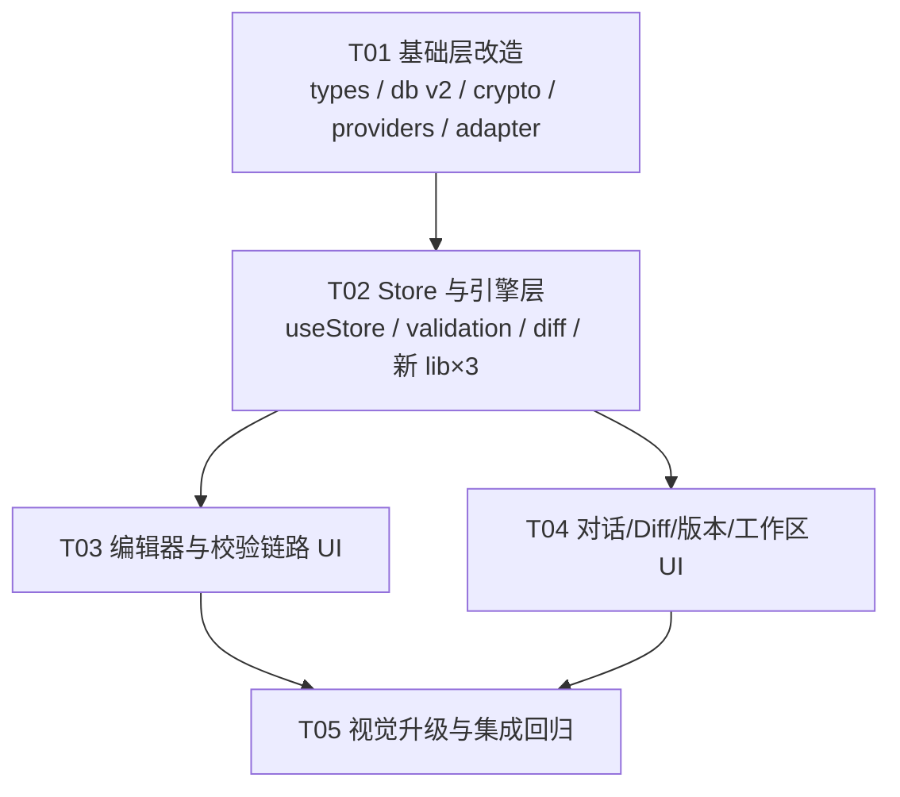

# PromptStudio 实现方案与任务分解（Impl Plan）

> 日期：2026-08-05 ｜ 架构师：Bob
> 输入：`docs/gap-analysis-2026-08-05.md`（P0×4 + P1×11）、`PromptStudio-模块功能说明.md`、src/ 代码快照
> 范围：P0 全部 4 项 + P1 全部 11 项。排除项按差距报告第 4 节结论，不纳入本计划。
> 约束：不引入文档未提及的新技术栈（diff-match-patch、WebCrypto、react-markdown、@codemirror/lang-yaml、lucide-react、Dexie 均已在依赖内，可直接使用）。

---

## 0. 总体技术策略

| 维度 | 决策 |
|---|---|
| 状态管理 | 继续沿用单一 Zustand store（`useStore.ts`），新能力全部以 action 形式追加，不拆分 store |
| 编辑器 | 沿用 CM6 Compartment 重配模式（现有 `lintConf` 已是 Compartment），只读/跳转均通过 compartment + dispatch 实现，不重建 EditorView |
| Diff 引擎 | 在现有 LCS 结果上做"重排块配对"后处理，不引入新 diff 库 |
| 持久化 | Dexie schema 从 v1 演进到 **v2**（纯新增表，无破坏性迁移，无需 upgrade 函数） |
| 密钥安全 | WebCrypto AES-256-GCM，设备级密钥以 non-extractable CryptoKey 存 IndexedDB |
| 规则提炼 | 第一期用**确定性启发式本地提炼**（不依赖 AI 调用），AI 辅助精修留作后续增强 |

### 架构一致性原则
1. 所有异步副作用（流式、DB 读写）集中在 store action 内，组件只调 action；
2. CM6 扩展重配一律走 `Compartment.reconfigure`，禁止销毁重建 view；
3. Dexie 版本号只增不减，新增表必须同步更新 `db.ts` 顶部的 schema 注释；
4. 组件间不直接传 editor 实例，通过 store 的 `pendingJumpLine` 等"意图字段"解耦。

---

## 1. P0 实现方案（4 项）

### P0-1｜规则集切换失效（差距 #9）

**技术方案**
- `useStore.ts` 新增 action：
  ```ts
  setRuleset: (id: string) => Promise<void>
  // set({ rulesetId: id }) → runValidation()
  // → db.docs.update(docId, { rulesetId: id })（持久化，刷新后保持）
  ```
- `runValidation` / `openDiff` 中规则集获取统一收口为新 helper `getActiveRuleset(state)`（内置 + 自定义合并查找，为 P1-5 铺路），替换现有 `RULESETS[rulesetId]` 直查（共 3 处：runValidation、doAutoOrganize、openDiff）。
- `TopBar.tsx`：`<select onChange={e => setRuleset(e.target.value)}>`，option 列表改为 store 的合并列表（内置 RULESETS + customRulesets）。

**涉及文件**：`src/store/useStore.ts`（改）、`src/components/Layout/TopBar.tsx`（改）、`src/data/rulesets.ts`（改，增加 `getAllRulesets` 合并函数签名）

**一致性**：沿用 Zustand action 模式；持久化走现有 `db.docs` 表字段（`rulesetId` 已在 schema 中，无需 bump 版本）。

**验收**：切换到"通用 Prompt"后校验结果刷新；刷新页面后选择保持。

---

### P0-2｜行内校验波浪线（差距 #3）

**技术方案**
- `CodeEditor.tsx`：
  - 重写 `createLinter`，在 linter 回调闭包内接收 `view: EditorView`，用 `view.state.doc.line(n)` 完成行号→偏移映射；越界行 clamp 到 `doc.lines`；from/to 取整行范围（`line.from` / `line.to`）。
  - 现有 `lintConf` Compartment 的初始值改为 `[]`（或仅 lintGutter 独立安装），新增 `useEffect` 监听 `validationIssues`：`view.dispatch({ effects: lintConf.reconfigure(issues.length ? linter(v => mapIssues(v, issues)) : []) })`。
  - lintGutter 保留，与波浪线同源于同一 linter。
- 关键代码形态：
  ```ts
  function mapIssues(view: EditorView, issues: ValidationIssue[]): Diagnostic[] {
    return issues.map(i => {
      const lineNo = Math.min(Math.max(i.line, 1), view.state.doc.lines);
      const line = view.state.doc.line(lineNo);
      return { from: line.from, to: line.to, severity: i.severity, message: i.message };
    });
  }
  ```

**涉及文件**：`src/components/Editor/CodeEditor.tsx`（改）

**一致性**：沿用 CM6 extension / Compartment 模式；linter 数据源复用 store 的 `validationIssues`，不新增校验通道。

**验收**：删掉 `name` 字段后对应行出现红色波浪线 + gutter 标记，hover 显示规则文案。

---

### P0-3｜校验面板点击跳转定位（差距 #4）

**技术方案**
- `useStore.ts` 新增：
  ```ts
  pendingJumpLine: number | null   // 意图字段，消费后清空
  jumpToLine: (line: number) => void  // set({ pendingJumpLine: line })
  ```
- `CodeEditor.tsx` 新增 `useEffect` 监听 `pendingJumpLine`：
  ```ts
  const pos = view.state.doc.line(clampedLine).from;
  view.dispatch({
    selection: { anchor: pos },
    effects: EditorView.scrollIntoView(pos, { y: 'center' }),
  });
  view.focus();
  // 消费后 useStore.setState({ pendingJumpLine: null })
  ```
- `ValidationPanel.tsx`：`onClick={() => jumpToLine(issue.line)}`，并给当前跳转目标加短暂高亮（复用 `highlightActiveLine`，focus 后 activeLine 自然高亮）。

**涉及文件**：`src/store/useStore.ts`（改）、`src/components/Editor/CodeEditor.tsx`（改）、`src/components/Editor/ValidationPanel.tsx`（改）

**一致性**：组件不持有 editor 实例引用，经 store 意图字段解耦（与 `pendingConfirmation` 等既有模式一致）。

**验收**：点击任意 issue，编辑器滚动至该行居中并选中、获得焦点。

---

### P0-4｜增量模式"选中区块"链路（差距 #18）

**技术方案**
- `CodeEditor.tsx`：updateListener 的选区分支中，在现有 `updateSelectionButton()` 之外同步调用 `setSelectedText(selectedText)`（空选区传 `''`），与浮动按钮共用同一 80ms 防抖。
- `useStore.ts` `buildContextMessages`：增量分支改为——
  - `selectedText` 非空：注入选中片段（现状保留）；
  - `selectedText` 为空：不发请求，直接 `toast('未选中内容：增量模式需要先在编辑器中圈选区块', 'error')` 并 return（在 `sendChatMessage` 入口早退），**不再静默退化为前 500 字**。
- `ChatPanel.tsx` context-bar：增量模式激活时追加显示选区状态：`已选 N 字符`（取自 `selectedText.length`）或黄色提示 `未圈选内容`。

**涉及文件**：`src/components/Editor/CodeEditor.tsx`（改）、`src/store/useStore.ts`（改）、`src/components/Chat/ChatPanel.tsx`（改）

**验收**：圈选后增量发送，DevTools 请求体仅含选中片段 + 规则摘要；无圈选时给出明确提示且不发送。

---

## 2. P1 实现方案（11 项）

### P1-1｜Diff 重排（reorder）检测（差距 #26）

**技术方案**（`src/lib/diff.ts`）
- 在 `buildDiffLines` 中，LCS + mergeReplacements 之后、buildFromOps 之前插入 **`detectReorders(ops)` 后处理**：
  1. 收集所有纯 `delete` 块与纯 `insert` 块（行数 ≥ 2，避免单行误判）；
  2. 对每个 delete 块，在 insert 块中查找**规范化内容相等**的配对（规范化 = 逐行 trim 后过滤空行再 join；完全相等判定失败时，用行级 LCS 相似度 ≥ 0.9 作为兜底）；
  3. 配对成功 → 将这对 delete/insert 标记为同一 `reordered` 变更块的两个 half，并从"待生成红绿块"中移除。
- `buildFromOps` 增加 `op.op === 'reorder'` 分支：左右两侧行均输出 `type: 'reordered'`，`changeBlockIdx` 指向同一 `ChangeBlock`（`type: 'reordered'`，oldSnippet/newSnippet 相同内容、行号不同——这本身就是"位置变了"的证据）。
- `ignoreReorder` 落地：`buildDiffLines` options 已有该形参签名；为 true 时重排配对直接按 `equal` 输出两侧行（不产生变更块）。store 新增 `ignoreReorder: boolean` + `setIgnoreReorder(val)`（切换后若 diffActive 则重跑 openDiff，与 ignoreWhitespace 同模式）；DiffView 工具条加 checkbox。
- `applyChanges`：reordered 块 accepted → 取 new 侧位置，rejected → 取 old 侧（复用现有分支逻辑即可，只需确认 cbIdx 对齐）。

**涉及文件**：`src/lib/diff.ts`（改）、`src/store/useStore.ts`（改）、`src/components/Diff/DiffView.tsx`（改，工具条 checkbox + change-summary 的 `reorder` key 已有映射兜底）

**风险**：配对启发式可能误判"内容恰好相同的两段"为重排。缓解：仅配对行数 ≥2 的块；一对配对成功后两侧都标记 consumed 不再参与其他配对。

**验收**：`doAutoOrganize` 产生的模块顺序变化显示为橙色"重排"，而非大片红绿。

---

### P1-2｜修改日志元信息填充（差距 #33）

**技术方案**（`src/store/useStore.ts`）
- `openDiff` 合并 explanation 的循环内，同时写入：
  ```ts
  cb.modelId = lastAssistantMsg.modelId;
  cb.tokens = lastAssistantMsg.tokens;
  cb.costEst = lastAssistantMsg.costEst;
  ```
- `createVersion`：保存前给传入的 changeBlocks 回填 `versionFrom = versions[0]?.label ?? 'v0'`、`versionTo = \`v${versionNumber}\``（在算出 versionNumber 之后、saveVersion 之前 map 一遍）。
- ModLogTab 已有渲染逻辑，无需改动。

**涉及文件**：`src/store/useStore.ts`（改）

**验收**：ModLog 元信息区显示模型名、token、成本、版本号。

---

### P1-3｜自动整理快照 + 预览确认（差距 #5）

**技术方案**
- `useStore.ts`：
  - 新增 state：`organizePreview: { before: string[]; after: string[]; result: string } | null`（before/after 为模块名有序列表，result 为整理后全文）；
  - `doAutoOrganize` 改为：计算 `autoOrganize()` 结果 → 用 `findModules` 取整理前后模块顺序 → `set({ organizePreview })`（**不直接应用**）；
  - 新增 `confirmAutoOrganize()`：`createVersion('自动整理模块顺序', preview.result, [])`（createVersion 内部已 setDocContent + runValidation + 持久化）→ 清空 preview；
  - 新增 `cancelAutoOrganize()`：清空 preview。
- 新增 `src/components/shared/ConfirmDialog.tsx`：通用确认弹层（标题 + 插槽内容 + 确认/取消），本任务用它渲染前后模块顺序两列对比（`A → B → C` 竖排列表，位置变化的模块用重排橙标记）。
- `TopBar.tsx`：渲染 `<ConfirmDialog>` 当 `organizePreview` 非空。

**涉及文件**：`src/store/useStore.ts`（改）、`src/components/Layout/TopBar.tsx`（改）、`src/components/shared/ConfirmDialog.tsx`（新）、`src/App.tsx`（改，挂载弹层）、`src/styles/index.css`（改，弹层样式）

**一致性**：快照复用现有 `createVersion`（与 Diff 全部处理完毕的路径同一入口），版本时间线自然出现新节点。

**验收**：点"自动整理"先弹顺序预览，确认后版本时间线出现"自动整理模块顺序"新版本。

---

### P1-4｜校验规则补齐（差距 #10/#11/#12/#13）

**技术方案**
- `src/types/index.ts`：
  - `StructureRule.type` 追加 `'forbid-field' | 'unknown-module'`；`forbid-field` 复用 `fields?: string[]`；
  - `FormatRule.type` 追加 `'yaml-frontmatter'`；
  - `RuleSet` 追加可选字段 `allowUnknownModules?: boolean`（默认 false = 告警）。
- `src/lib/validation.ts`：
  - **forbid-field**：frontmatter `fields` 中命中 `rule.fields` → 按 `rule.level` 报 issue（line 取该字段在 raw 中的行号）；
  - **unknown-module**：`findModules` 结果中未匹配任何 orderRules 且 `!ruleset.allowUnknownModules` → warning「未知模块: X，将排序至末尾」；
  - **yaml-frontmatter**：用已安装的 `@codemirror/lang-yaml` 的 `yamlLanguage.parser` 解析 `parseFrontmatter().raw`，遍历 syntax tree 检出 `⚠` error 节点 → error 级 issue（line 取节点行）；解析器对不完整输入容错，仅在真有 error 节点时报告；
  - **imperative-verbs**（StyleRule 已声明该 type，补实现）：启发式——Instructions 类模块（模块名含 instruction/指令）内，列表项或句首匹配 `/^[-*\d.]*\s*(你应该|你可以|你需要|You should|You can|You may)/i` → info「建议使用祈使句」。
- `src/data/rulesets.ts`：anthropic-skill 规则集挂载新规则示例（如 forbid-field: `['系统提示词']`→ 实际 forbid 字段示例 `['internal-notes']`；unknown-module 默认开启 warning）。

**涉及文件**：`src/types/index.ts`（改）、`src/lib/validation.ts`（改）、`src/data/rulesets.ts`（改）

**风险**：imperative-verbs 为启发式，误报级别定 `info`，不阻断。

**验收**：四类规则各有正/反用例命中（在 sample 文档中构造用例手工验证）。

---

### P1-5｜规则集导入 + 自定义规则集（差距 #15/#8）

**技术方案**
- `src/data/rulesets.ts`：补第 4 套内置 `'custom-blank'`（自定义空白模板：全规则空数组 + `allowUnknownModules: true`）；新增 `mergeRulesets(custom: RuleSet[])` helper。
- `src/store/db.ts`（**schema v2**）：新增表 `rulesets: 'id, name, createdAt'`，及 `saveRuleset / getCustomRulesets / deleteRuleset` 函数。
- `src/lib/rulesetExtract.ts`（新）：**确定性本地提炼**——
  - 解析导入的规范 .md：提取 frontmatter 字段名集合 → `require-frontmatter` 草案；`##` 标题序列 → `orderRules` 草案；含代码块 → `codeblock-language`；标题最深层级 → `heading-depth`；
  - 返回 `RuleSet` 草案对象（`id: 'custom-' + ts`，`name` 取文件名）。
- `src/components/Ruleset/RulesetImportModal.tsx`（新）：文件选择/拖拽入口 → 展示草案（三类规则分组 checkbox 列表，可逐条去留、可改名）→ 确认 → `saveCustomRuleset`。
- `useStore.ts`：state `customRulesets: RuleSet[]`；actions `loadCustomRulesets()`（init 时调）、`saveCustomRuleset(rs)`、`removeCustomRuleset(id)`；`getActiveRuleset` 合并查找（P0-1 已收口）。
- `TopBar.tsx`：规则集下拉列出内置+自定义；下拉旁加"导入规则集"按钮打开弹层。
- 自定义规则集被删除且当前正在使用 → 回退 `anthropic-skill`。

**涉及文件**：`src/data/rulesets.ts`（改）、`src/store/db.ts`（改，v2）、`src/lib/rulesetExtract.ts`（新）、`src/store/useStore.ts`（改）、`src/components/Ruleset/RulesetImportModal.tsx`（新）、`src/components/Layout/TopBar.tsx`（改）、`src/styles/index.css`（改）

**风险**：Dexie v2 为纯新增表，老数据自动保留；若用户浏览器已有 v1 库，Dexie 自动升级无需 upgrade 回调。

**验收**：导入一份规范 .md → 生成可编辑草案 → 确认后出现在 TopBar 下拉并立即生效；刷新后仍在。

---

### P1-6｜供应商扩至 8 家 + Gemini Query-key 鉴权（差距 #23/#40）

**技术方案**
- `src/data/providers.ts`：新增 5 个模板——
  | providerId | compat | auth | baseUrl | 说明 |
  |---|---|---|---|---|
  | `gemini` | `gemini`（新） | `query-key`（`queryParam: 'key'`） | `https://generativelanguage.googleapis.com/v1beta` | SSE `streamGenerateContent` |
  | `moonshot` | `openai` | bearer | `https://api.moonshot.cn/v1` | 模型 kimi-k2 等 |
  | `qwen` | `openai` | bearer | `https://dashscope.aliyuncs.com/compatible-mode/v1` | 通义千问 |
  | `ollama` | `openai` | `none` | `http://localhost:11434/v1` | 本地直连，无鉴权 |
  | `openrouter` | `openai` | bearer | `https://openrouter.ai/api/v1` | 聚合网关 |
- `src/lib/api/adapter.ts`：
  - `sendMessage` 分发增加 `template.compat === 'gemini'` → `sendGemini()`：URL 为 `${baseUrl}/models/${model}:streamGenerateContent?alt=sse&key=${apiKey}`；body `{ system_instruction, contents: [{role, parts:[{text}]}] }`；SSE 解析 `candidates[0].content.parts[].text` 累加；
  - auth 装配抽为 `applyAuth(headers, url, template, apiKey)` 工具函数，`query-key` 时拼 query 而非 header，`none` 时跳过；`sendOpenAICompatible` / `testConnection` 统一改用它；
  - `testConnection` 对 gemini 用非流式 `:generateContent?key=` 探活；Ollama 探测失败时文案特化「请确认 Ollama 已启动（ollama serve）」。
- `src/lib/crypto.ts` `PRICING` 表补新模型单价（gemini-2.5-flash/pro、kimi-k2、qwen-plus/qwen-max、openrouter 通用档位；Ollama 本地计 0）。
- `ChatPanel.tsx` 模型下拉自动从新模板 flatMap，无需改结构（确认 `PROVIDER_TEMPLATES` 增加后自然出现）。
- `SettingsModal.tsx`：Gemini 卡片提示"Key 将以 URL 参数形式发送（Google 官方鉴权方式）"；Ollama 隐藏 API Key 输入框。

**涉及文件**：`src/data/providers.ts`（改）、`src/lib/api/adapter.ts`（改）、`src/lib/crypto.ts`（改，定价表）、`src/components/Settings/SettingsModal.tsx`（改）

**验收**：5 家新模板均出现在供应商列表；Ollama 本地实测通过；其余以 401/404 错误分类正确为准。

---

### P1-7｜API Key AES-256-GCM 加密存储（差距 #39）

**技术方案**（`src/lib/crypto.ts` 重写密钥部分）
- 设备密钥：`getOrCreateDeviceKey(): Promise<CryptoKey>`——
  - 首选从 IndexedDB 读（Dexie v2 新增表 `keystore: 'id'`，存 non-extractable `CryptoKey` 对象本身，IndexedDB 支持结构化克隆）；
  - 不存在则 `crypto.subtle.generateKey({ name: 'AES-GCM', length: 256 }, false, ['encrypt','decrypt'])` 并写入。
- 加解密：
  ```ts
  saveApiKey(providerId, key): Promise<void>
  // iv = crypto.getRandomValues(new Uint8Array(12))
  // cipher = subtle.encrypt({name:'AES-GCM', iv}, deviceKey, encode(key))
  // localStorage: 'ps_key_<id>' = 'v2:' + base64(iv ‖ cipher)
  getApiKey(providerId): Promise<string>  // 'v2:' 前缀 → 解密；无前缀（旧 base64）→ 解密旧格式后自动以 v2 重写（透明迁移）
  ```
- **调用方 async 化**：`useStore` 的 `init` / `sendChatMessage` / `doTestConnection` / `doSaveSettings` / `openSettings` 中所有 `getApiKey` 调用改 `await`（这些函数本已 async 或易改）；`maskApiKey` 保持同步纯函数。
- `SettingsModal.tsx` 安全文案修正：删除"系统凭据库优先"表述，改为「API Key 使用 AES-256-GCM 加密存储于本机（WebCrypto），密钥不出设备；纯网页环境无法访问系统凭据库，桌面版将提供更强保护」。

**涉及文件**：`src/lib/crypto.ts`（改）、`src/store/db.ts`（改，v2 keystore 表）、`src/store/useStore.ts`（改，await 化）、`src/components/Settings/SettingsModal.tsx`（改，文案）

**风险**：`crypto.subtle` 仅在 secure context（https/localhost）可用——本应用为 `vite dev` localhost 场景，满足；需在 `getOrCreateDeviceKey` 加 `crypto.subtle` 存在性降级（不可用时回退旧 base64 并 console.warn）。

**验收**：localStorage 中无明文/可逆 base64（均带 `v2:` 前缀密文）；重启后自动解密可用；测试连接正常。

---

### P1-8｜划词工具栏四操作 + 自动发送 + Diff 面板选区（差距 #47/#48/#49/#51）

**技术方案**
- 新增 `src/components/shared/SelectionToolbar.tsx`：
  ```ts
  interface SelectionToolbarProps {
    anchor: { top: number; left: number } | null;  // 相对视口坐标
    charCount: number;
    source: 'editor' | 'diff-left' | 'diff-right';
    onAction: (action: 'ask' | 'explain' | 'improve' | 'fix') => void;
    onClose: () => void;
  }
  ```
  纯展示组件：字符数 + 4 按钮（询问/解释/优化/修复，Lucide 图标），`fixed` 定位、位置自适应（上方不足 60px 翻转到下方），外观沿用 hover-bubble 的玻璃拟态。
- `useStore.ts` 新增 action：
  ```ts
  selectionQuickAction: (action, payload: { text, source, startLine?, endLine? }) => void
  // 1. 组装 sourceLabel（编辑器→模块标题+L行号；diff-left→'修改前（左）'；diff-right→'修改后（右）'）
  // 2. setChatReference({ text, sourceLabel, ... })
  // 3. setActiveView('editor') 确保 ChatPanel 可见
  // 4. explain / improve → 直接 sendChatMessage(预置 prompt)（引用拼接复用 ChatPanel 既有逻辑——见下）
  //    ask / fix → 仅置引用 + 预填输入框，等用户补充
  ```
  预置 prompt 文案移植自旧版 `js/selection-toolbar.js` 的 `prompts` 表（四段模板原文沿用）。
  为支持"自动发送时拼接引用"，`sendChatMessage` 内部改为：**若 `chatReference` 存在则自动拼接 blockquote 并清除**（把 ChatPanel handleSend 里的拼接逻辑上移到 action 内，ChatPanel 简化为只传原文）。
- `CodeEditor.tsx`：替换现有单一"引用到对话"按钮——选区出现时渲染 `<SelectionToolbar source="editor" …>`（复用现有 selButton 状态与坐标计算，≥2 字符门槛沿用）；`ask` 行为即原 `handleAddToChat`。
- `DiffView.tsx`：左右 `.pane-content` 挂 `onMouseUp`，用 `window.getSelection()` 捕获（判定 anchorNode 在左/右 pane），50ms 防抖，经 portal 渲染同一 `<SelectionToolbar>`；Esc/滚动/点外部隐藏（全局 listener 挂 toolbar 组件内）。
- 隐藏时机、50ms 延迟、≥2 字符三参数与模块说明第 9 章对齐。

**涉及文件**：`src/components/shared/SelectionToolbar.tsx`（新）、`src/components/Editor/CodeEditor.tsx`（改）、`src/components/Diff/DiffView.tsx`（改）、`src/store/useStore.ts`（改）、`src/components/Chat/ChatPanel.tsx`（改，引用拼接上移后简化）、`src/styles/index.css`（改，toolbar 样式）

**验收**：编辑器与 Diff 两侧划词均出四操作工具栏；点"优化"自动发送且消息带结构化引用（📎 来源标识）。

---

### P1-9｜工作区只读强制 + 圈选建范围 + 持久化（差距 #43/#44/#45）

**技术方案**
- **持久化**（`db.ts` v2 新增表）：
  - `workspaces: 'id, docId, createdAt'`（存 WorkspaceScope + docId 外键）；
  - `imports: 'path, docId, importedAt'`（path 为主键，存 ImportedFileInfo + docId）；
  - store 的 workspace/import 系列 action 全部改为 write-through（内存 set 后异步 put/delete）；`init` 中按 docId load 回填。
- **编辑器只读**（`CodeEditor.tsx`）：
  - 新增 Compartment `readOnlyConf`，扩展为 `EditorState.transactionFilter.of(tr => …)`：
    - 无激活范围（`currentScopeId` 为空）→ 放行全部；
    - 有激活范围：计算**可编辑区间** = 激活范围中 `selected && !locked` 模块的行范围（行号→`doc.line(n).from/to` 偏移）；对每个 `tr.changes`，若变更区间与可编辑区间无交集（或 tr.newDoc 在锁定区有改动）→ 返回 `[]` 阻断；
    - 范围锁定时（scope.locked）整组模块不可编辑。
  - `useEffect` 监听 `workspaceScopes / currentScopeId` 变化 → `readOnlyConf.reconfigure(...)`；
  - 视觉辅助：StateField + Decoration 给只读行加 `cm-locked-line` 行背景类（浅灰斜纹或降低透明度），gutter 加 🔒 标记可后置（本期只做行底色）。
  - 文档编辑后模块行号会漂移：filter 内**每次基于当前 doc 重新解析标题**（复用 `parseDocumentModules` 的纯函数版本抽离到 `src/lib/`，store 与编辑器共用），不依赖 scope 里存的旧行号做精确匹配，而以"标题名匹配 + 当前行号"为准。
- **圈选建范围**（`WorkspaceScope.tsx`）：
  - 已导入文件列表每行前加 checkbox（新 state `checkedPaths: Set<string>`），工具条出现「组成新工作区 (N)」按钮（N>0 时可用）；
  - 点击 → 对每个勾选文件的 content 跑 `parseModulesFromContent()` → 模块 heading 以 `文件名/标题` 命名聚合 → `createScope(name, desc, aggregatedModules)`（弹小输入框取名，复用现有 create 表单模式）。

**涉及文件**：`src/store/db.ts`（改，v2）、`src/store/useStore.ts`（改，write-through + load + 抽离 parse 纯函数）、`src/lib/scopeParse.ts`（新，从 useStore 抽出的 parseDocumentModules 纯函数版）、`src/components/Editor/CodeEditor.tsx`（改，transactionFilter + 只读装饰）、`src/components/Workspace/WorkspaceScope.tsx`（改，checkbox + 组成按钮）、`src/styles/index.css`（改，cm-locked-line 等）

**风险**：transactionFilter 全量阻断策略对 IME 输入需确认（CM6 composition 走同一事务管线，区间判定基于变更位置，不受影响）；行号漂移已通过"按标题名动态解析"规避。

**验收**：锁定范围内敲键盘无变化；勾选 2 个导入文件一键建范围；刷新后范围与文件仍在。

---

### P1-10｜版本迭代 AI 摘要（差距 #36）

**技术方案**（第一期：**确定性合成**，不调 AI——changeBlocks 已含 Why/How/Effect，合成摘要不需重读全文也不需要模型；AI 润色留作后续增强位）
- `useStore.ts` 新增 action：
  ```ts
  generateVersionSummary: (versionId: string) => Promise<void>
  // 1. db.versions.get → 若 summaryStatus==='ready' 直接返回（秒开 ≤500ms 的来源）
  // 2. set summaryStatus='generating'（UI 骨架态）
  // 3. summaryBrief = changeBlocks.slice(0,5).map(cb => `${类型图标} ${cb.explanation?.why?.slice(0,60) || cb.newSnippet.slice(0,60)}`)
  //    summaryDetail = 全量 Markdown 列表（每块：类型徽标 + Why/How/Effect 三段）
  // 4. updateVersion(id, { summaryBrief, summaryDetail, summaryStatus: 'ready' }) → loadVersions()
  ```
- `VersionTimeline.tsx`：版本节点 actions 区加「摘要」按钮——
  - 第一击：`generateVersionSummary` 后展开 inline 摘要卡（3-5 条 brief）；
  - 摘要卡内「展开全部」→ 渲染 summaryDetail（react-markdown，复用 ChatPanel 的渲染组件抽为 shared）；
  - `summaryStatus==='generating'` 时显示骨架屏（按品牌规范 §6）。

**涉及文件**：`src/store/useStore.ts`（改）、`src/components/Version/VersionTimeline.tsx`（改）、`src/components/shared/MarkdownView.tsx`（新，从 ChatPanel 抽出共用）、`src/store/db.ts`（改，`updateVersionSummary` 便捷函数）、`src/styles/index.css`（改，摘要卡样式）

**验收**：摘要与变更块一一对应；二次打开秒开（≤500ms，直接读持久化字段）。

---

### P1-11｜工作区引用检索（差距 #46，PRD 5.2.2）

**技术方案**（第一期：路径显式识别 + @提及模糊匹配；BM25 全文检索后置）
- 新增 `src/lib/referenceSearch.ts`：
  ```ts
  detectPathMentions(text: string): string[]            // 正则提取含 '/' 或 '.md/.txt' 结尾的 token
  matchImportedFiles(mention: string, files: ImportedFileInfo[]): { file, score, confidence: 'exact'|'fuzzy' }[]
  // exact：path 后缀完全匹配；fuzzy：子序列匹配打分（字符有序出现率），阈值 ≥0.6
  ```
- `useStore.ts`：
  - state：`pendingReferences: PendingReference[]`（`{ id, mention, file, confidence, status: 'pending'|'confirmed'|'dismissed', tokenEst }`）；
  - actions：`detectReferences(text)`（输入防抖 300ms 调用）、`confirmReference(id)`、`dismissReference(id)`；
  - `buildContextMessages`：把 status==='confirmed' 的引用文件内容以 `## 引用文件 <path>\n<content>` 注入（**确认前永不注入**，硬约束）；注入后 toast 告知实际注入的 token 数。
- `ChatPanel.tsx`：
  - textarea onChange（已有 handleInput）追加 `detectReferences(value)` 防抖调用；
  - 输入区上方（chatReference 块之上）渲染**引用确认条**：每个 pending 引用一个 chip——文件名 + 置信标记（✓ 精确 / ？疑似）+ `~N tokens` + [确认] [移除] 按钮；
  - chip 点击文件名 → 只读预览 popover（前 40 行，等宽字体，不可编辑）；
  - 发送成功后清空 pendingReferences。

**涉及文件**：`src/lib/referenceSearch.ts`（新）、`src/store/useStore.ts`（改）、`src/components/Chat/ChatPanel.tsx`（改）、`src/styles/index.css`（改，确认条/预览 popover）

**验收**：消息含 `references/fields.md` 时出现待确认 chip；确认后注入上下文（DevTools 可验证）；未确认不注入；全程可见可改。

---

## 3. Dexie Schema 演进（v1 → v2）

```ts
// db.ts —— 版本号 1 → 2，纯新增表，无需 upgrade 回调
this.version(1).stores({
  docs: 'id, name, rulesetId, updatedAt',
  versions: 'id, docId, versionNumber, createdAt',
  chats: 'id, docId, updatedAt',
});
this.version(2).stores({
  docs: 'id, name, rulesetId, updatedAt',
  versions: 'id, docId, versionNumber, createdAt',
  chats: 'id, docId, updatedAt',
  rulesets: 'id, name, createdAt',        // P1-5 自定义规则集
  workspaces: 'id, docId, createdAt',     // P1-9 工作区范围
  imports: 'path, docId, importedAt',     // P1-9 导入文件（path 主键）
  keystore: 'id',                         // P1-7 设备级 AES 密钥（CryptoKey 结构化克隆）
});
```

约定：后续任何 schema 变更必须 bump 版本号并保留全部历史版本定义；只做加法（新表/新索引），不删字段；破坏性变更另写 upgrade 迁移函数并在 PR 描述中标注。

---

## 4. 任务列表（有序 · 含依赖 · 含并行批次）

> 硬约束执行：共 5 个任务，每个任务 ≥3 个相关文件；T01 为基础层（类型 + schema + 基础设施）。

| Task | 名称 | 覆盖差距项 | 源文件（相对路径） | 依赖 | 优先级 |
|---|---|---|---|---|---|
| **T01** | 基础层改造：类型扩展 + Dexie v2 + 加密存储 + 供应商扩展 | P1-6、P1-7，并为 P0/P1 其余项提供类型与 schema 底座 | `src/types/index.ts`、`src/store/db.ts`、`src/lib/crypto.ts`、`src/data/providers.ts`、`src/lib/api/adapter.ts`、`src/components/Settings/SettingsModal.tsx` | — | P0 |
| **T02** | Store 与引擎层：全部新 action + 校验规则补齐 + 重排检测 + 规则提炼/引用检索纯函数库 | P0-1(store)、P0-3(store)、P0-4(store)、P1-1、P1-2、P1-3(store)、P1-4、P1-5(逻辑)、P1-9(store)、P1-10(逻辑)、P1-11(逻辑) | `src/store/useStore.ts`、`src/lib/validation.ts`、`src/lib/diff.ts`、`src/data/rulesets.ts`、`src/lib/rulesetExtract.ts`(新)、`src/lib/referenceSearch.ts`(新)、`src/lib/scopeParse.ts`(新) | T01 | P0 |
| **T03** | 编辑器与校验链路 UI：波浪线 + 点击跳转 + 划词工具栏 + 只读强制 + TopBar/确认弹层 | P0-1(UI)、P0-2、P0-3(UI)、P0-4(编辑器侧)、P1-3(UI)、P1-8(编辑器侧)、P1-9(只读) | `src/components/Editor/CodeEditor.tsx`、`src/components/Editor/ValidationPanel.tsx`、`src/components/Layout/TopBar.tsx`、`src/components/shared/SelectionToolbar.tsx`(新)、`src/components/shared/ConfirmDialog.tsx`(新)、`src/App.tsx` | T02 | P0 |
| **T04** | 对话/Diff/版本/工作区/规则集 UI：四操作接入 Diff、引用确认条、版本摘要、圈选建范围、规则集导入弹层 | P1-5(UI)、P1-8(Diff/Chat 侧)、P1-9(UI)、P1-10(UI)、P1-11(UI) | `src/components/Chat/ChatPanel.tsx`、`src/components/Diff/DiffView.tsx`、`src/components/Version/VersionTimeline.tsx`、`src/components/Workspace/WorkspaceScope.tsx`、`src/components/Ruleset/RulesetImportModal.tsx`(新)、`src/components/shared/MarkdownView.tsx`(新) | T02 | P1 |
| **T05** | 视觉升级与集成回归：按品牌视觉规范统一 token 与组件样式、全链路联调 | 全部项的最终整合 + 视觉规范落地 | `src/styles/index.css`、`src/App.tsx`（微调）、`src/components/**`（样式类名对齐，不改逻辑）、`docs/brand-visual-spec-2026-08-05.md`（验收依据） | T03、T04 | P1 |

### 并行批次

```
批次 1：T01                    （独立先行，类型/schema 是所有人的底座）
批次 2：T02                    （依赖 T01 的类型与 db v2）
批次 3：T03 ∥ T04              （T02 完成后可完全并行，文件无交集）
批次 4：T05                    （最后统一视觉 + 联调回归）
```

### 任务依赖图



---

## 5. 共享知识约定（跨文件）

### 5.1 命名规范
- **Store action**：动词开头 camelCase——读操作 `load*/get*`，写操作 `set*/save*/create*/delete*`，流程操作 `do*`（doAutoOrganize、doTestConnection 既有惯例延续），异步 action 返回 `Promise<void>`；
- **意图字段**（组件间解耦用的一次性 state）：`pending*` 前缀（pendingJumpLine、pendingReferences），消费方用后立即清空；
- **新文件**：组件 `PascalCase.tsx`，lib/工具 `camelCase.ts`，组件与样式类同名前缀（SelectionToolbar → `.selection-toolbar`）；
- **类型**：新增 interface 集中放 `src/types/index.ts`，禁止在组件文件内定义跨文件复用的类型。

### 5.2 Zustand action 约定
- 所有 DB 读写只能出现在 store action 或 `db.ts` 的封装函数内，组件禁止直接 `import { db }`；
- action 内先 `set()` 内存态、再异步持久化（write-through），持久化失败 console.error + toast，不回滚内存态；
- 每个新 action 必须在 `AppState` interface 中同步声明签名（TS 强制）。

### 5.3 CSS 类名约定
- 沿用现有 BEM 风格短前缀：模块前缀 + 元素（`.ws-scope-card`、`.cs-item`、`.hbe-row`）；
- 新组件类名前缀：SelectionToolbar→`.st-`（沿用旧版惯例）、ConfirmDialog→`.confirm-`、RulesetImportModal→`.rs-`、引用确认条→`.ref-`、版本摘要卡→`.vsum-`；
- 颜色/圆角/间距/字体一律引用 CSS 变量（见品牌视觉规范），禁止组件内硬编码 hex（动态 iconBg 等数据驱动色除外）。

### 5.4 Dexie schema 演进约定
- 版本号只增不减；历史版本定义原样保留（见 §3 模板）；
- 新增表必须同时提供 `save*/get*/delete*` 封装函数（与 saveVersion/getVersions 同风格）；
- 主键策略：业务唯一键能做主键就用主键（imports.path），否则 `id` 字符串 + 必要索引。

### 5.5 其他横切约定
- 时间戳一律 `Date.now()`（number）；UI 展示用 `toLocaleString()`；
- token 估算统一 `estimateTokens()`（4 字符≈1 token），成本估算统一 `estimateCost()`，禁止各自实现；
- toast 统一走 `src/components/shared/Toast.tsx` 的 `toast(message, type)`，禁止 `alert()`（既有遗留 alert 在 T05 顺带替换）；
- 确认对话框：危险操作（全量拒绝等）暂沿用 `confirm()`，新增流程一律用 `ConfirmDialog`；T05 视情况统一替换。

---

## 6. 不明确项与假设

1. **Gemini SSE 确切帧格式**未在文档中给出——按 Google 官方 `:streamGenerateContent?alt=sse` 常规格式（`data: {candidates:[{content:{parts:[{text}]}}]}`）实现，联调时以实测为准；
2. **AI 辅助规则提炼**降级为确定性本地提炼（第一期），模块说明的"系统辅助提炼"以启发式草案 + 人工确认满足；若产品要求必须 AI 提炼，需追加一个复用 sendMessage 的专用调用（不阻塞本期）；
3. **版本摘要**第一期为确定性合成而非 AI 生成——依据：changeBlocks 已持久化 Why/How/Effect，PRD"基于已持久化 changeBlocks 合成摘要（不重读全文）"字面满足；AI 润色位已预留（summaryStatus 状态机兼容异步生成）；
4. **Ollama 跨域**：默认 `http://localhost:11434` 在 https 页面下存在混合内容限制——本应用以 `vite dev`（http://localhost）运行为主要场景，满足；生产 https 部署时需在文档中提示用户配置 OLLAMA_ORIGINS；
5. **编辑器只读的行号漂移**：采用"按标题名动态解析当前行号"策略，scope 中存储的 startLine/endLine 仅作展示，不作为只读判定依据（判定以实时解析为准）；
6. **BM25 全文检索**按差距报告口径后置，第一期为路径匹配 + 子序列模糊打分。
